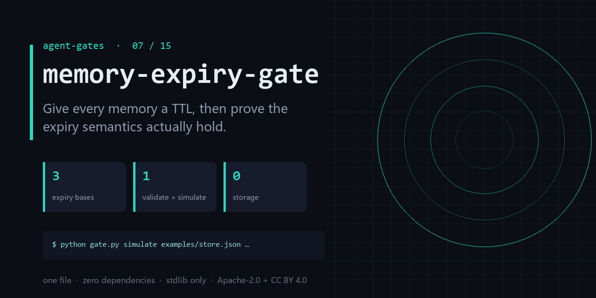

<div align="center">

</div>

<h1 align="center">memory-expiry-gate</h1>

<p align="center"><b>Give every memory a TTL, then prove the expiry semantics actually hold.</b><br><sub>one file · zero dependencies · stdlib only</sub></p>

<p align="center"><a href="https://github.com/chenhz01/memory-expiry-gate/actions/workflows/gate.yml"></a>   </p>

---

## The failure this catches

- A temporary decision from three months ago is still being executed as a hard rule.
- Nobody wrote down when a memory should be forgotten, so it never is.
- The policy declares a TTL, the implementation checks created_at, and the semantics are wrong.

One command, on a file you already have:

```bash
python gate.py validate examples/policy.json && \
  python gate.py simulate examples/store.json examples/policy.json --now 2026-10-19T00:00:00Z
```

<details>
<summary><b>Real output</b> — produced by the bundled <code>examples/</code>, not a mock-up</summary>

```text
m1 -> hard_delete (rule:id=r1)
m2 -> demote (rule:id=r2)
m3 -> soft_delete (default)
m4 -> keep (default)
kept=1 audit=3
```

</details>

## What it does

- Validates TTL declarations, expiry basis, and class coverage in one pass.
- Simulates a store at a given `--now` and reports what would be swept.
- Makes「该忘没忘」a CI failure instead of a slow-motion incident.

## What it does **not** do

- It is a policy and semantics checker — it does not store your memories.
- It cannot know which memory is still true; only you can declare that.
- Bench numbers are throughput only, not retrieval quality.

Being explicit here is cheaper than a wrong expectation later.

## Exit codes

`0` = policy is valid and applied. `1` = policy errors (missing TTL, contradictory rules). `2` = bad input. **The bundled example is a valid policy — it exits 0 on purpose.**

## Install

```bash
git clone https://github.com/chenhz01/memory-expiry-gate
cd memory-expiry-gate
python gate.py --help
```

Python 3.9+. Nothing to `pip install` — stdlib only.

## Use it in CI

```yaml
- name: memory-expiry-gate
  run: python gate.py simulate examples/store.json examples/policy.json --now 2026-10-19T00:00:00Z
```

## Use it as a GitHub Action

`action.yml` is included, so you can call this repo directly as a composite action.

```yaml
# .github/workflows/gates.yml
- uses: actions/checkout@v4

- uses: chenhz01/memory-expiry-gate@v0.1.0
  with:
    # IMPORTANT: this path is inside YOUR repository.
    # The examples/ in this repo are NOT in your workspace — pass your own files.
    args: "simulate path/to/store.json path/to/policy.json --now 2026-10-19T00:00:00Z"
```

Pin the tag (`@v0.1.0`) rather than `@main` — `main` moves.

If you omit `args`, the action only prints help and exits 0. It raises a warning
annotation so a green check is never mistaken for "it inspected my files".


## 中文速览

**记忆过期门** — 给每条记忆声明 TTL，再验证「过期」这件事真的按你说的生效。

- 三个月前一个临时决定，今天还在被当成硬规则执行。
- 「这条记忆什么时候该忘」没人写下来，于是它永远不忘。
- 策略写了 TTL，实现按 created_at 判，语义其实全错了。

一行命令：`python gate.py simulate examples/store.json examples/policy.json --now 2026-10-19T00:00:00Z`

边界：It is a policy and semantics checker — it does not store your memories.

## The gates

| # | gate | what it stops |
|---|---|---|
| 02 | **[loop-gate](https://github.com/chenhz01/loop-gate)** | Find where your agent looped, before it burns another run |
| 03 | **[permission-gate](https://github.com/chenhz01/permission-gate)** | Score how much more your agent can do than it should |
| 04 | **[context-gate](https://github.com/chenhz01/context-gate)** | Measure what truncation deletes, before the model starts guessing |
| 05 | **[instruction-gate](https://github.com/chenhz01/instruction-gate)** | Two of your instructions contradict each other. This finds them |
| 06 | **[output-gate](https://github.com/chenhz01/output-gate)** | Before AI-written text ships, run the four checks it always fails |
| 07 | **memory-expiry-gate** ← you are here | Give every memory a TTL, then prove the expiry semantics actually hold |
| 08 | **[drift-gate](https://github.com/chenhz01/drift-gate)** | When embeddings drift, retrieval quietly rots. Fingerprint it |
| 09 | **[price-gate](https://github.com/chenhz01/price-gate)** | Your cost model is only as good as the price table under it |
| 10 | **[complexity-ceiling](https://github.com/chenhz01/complexity-ceiling)** | Per-file complexity budgets that fail the build instead of the reviewer |
| 11 | **[deadcode-gate](https://github.com/chenhz01/deadcode-gate)** | Quantify how much of the repo is dead, instead of guessing |
| 12 | **[docrot-gate](https://github.com/chenhz01/docrot-gate)** | Docs don't die at once. They rot one stale command at a time |
| 13 | **[leak-gate](https://github.com/chenhz01/leak-gate)** | Scan for internal detail before the doc leaves the building |
| 14 | **[backup-gate](https://github.com/chenhz01/backup-gate)** | A backup you have never verified is a rumor |
| 15 | **[trail-gate](https://github.com/chenhz01/trail-gate)** | Hash-chained agent audit trail — and it verifies its own chain |

## License

- Code: **Apache-2.0** — see [LICENSE](LICENSE)
- Docs and example data: **CC BY 4.0** — see [LICENSE-SPEC](LICENSE-SPEC)

Attribution required when you redistribute the documentation; code can be used commercially
without a separate agreement. See [NOTICE](NOTICE).
